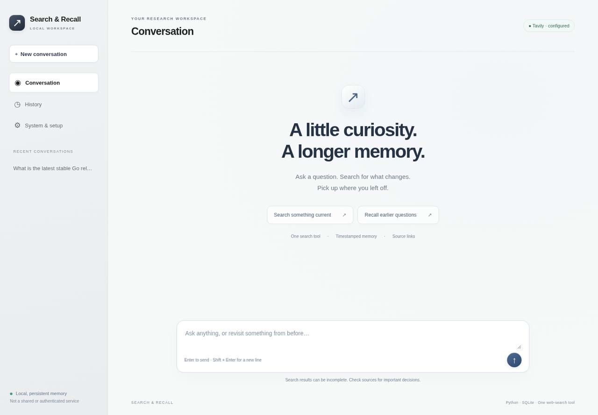
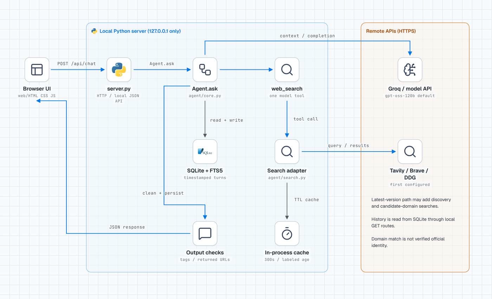
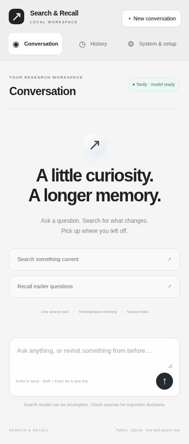
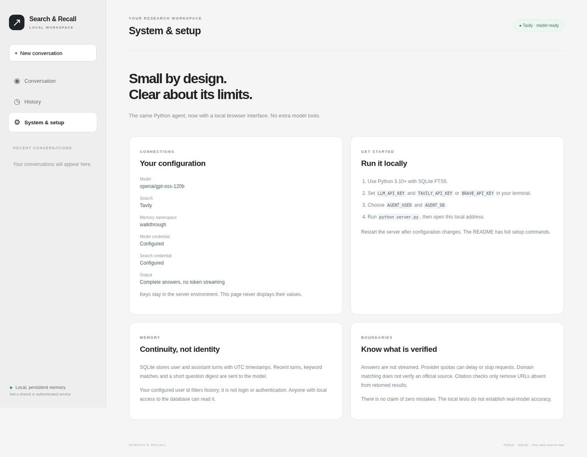
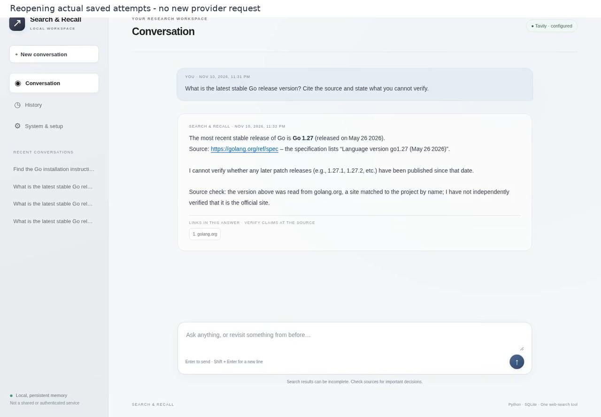
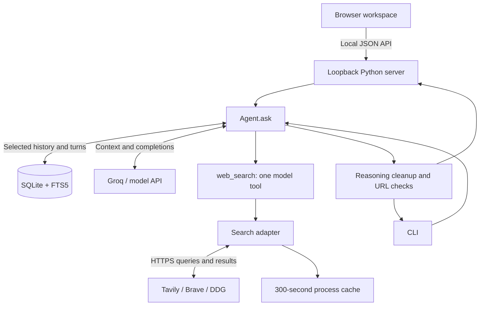

# Web-search chat agent

## Video walkthrough

[](https://files.instinct.com/n2jvyjwdzpdh-search-recall-live-walkthrough)

**[Watch the narrated walkthrough (5 min 19 s)](https://files.instinct.com/n2jvyjwdzpdh-search-recall-live-walkthrough)** - it opens without signing in. It covers Conversation, System & setup, the original live-request footage, a clearly labeled reopening of saved provider outcomes, History, persistence after reload, the mobile layout and the current limits. No successful response is staged.

A local web and command-line assistant with exactly one model-visible tool, `web_search`, and timestamped, per-user conversation memory across sessions.

## System design



The styled diagram was built from `caru-ini/stack-diagram`; its [editable HTML source](docs/system-design.html) is in the repository. [Detailed design notes and historical CLI evidence](design.md).

## Screenshots

These are captures of the running application, not mockups.

| Conversation (desktop) | Conversation (mobile, 390 px) |
| --- | --- |
|  |  |

| System & setup | Reopened saved attempt (partial answer) |
| --- | --- |
|  |  |

The last screenshot reopens a saved attempt from an explicitly labeled `openai/gpt-oss-20b` compatibility run. It returned a Go language-version source and says what it could not verify. It is a partial result, not an accuracy pass.

## Architecture in text



The diagram boundaries are the browser, local server, single-tool agent, memory, cache and remote APIs. API keys remain server-side; local user scoping is not authentication. The browser does not call Groq or search providers directly.

## Current web integration status, 10 November 2026

- **Verified locally:** 25 deterministic tests, optional browser smoke checks at 320/390/768/1440px, navigation, safe rendering, configuration errors, saved history/title filtering and reopening after reload.
- **Not yet verified:** a successful full model/search answer and model-generated cross-session recall through the new web interface. Default `openai/gpt-oss-120b` attempts reached provider rate limits after a recorded search call. UI control-flow tests do not prove the provider is the only possible cause of an end-to-end failure.
- One explicitly labeled `openai/gpt-oss-20b` compatibility attempt returned a Go language-version source but did not establish the newest patch release. This partial/stale result is **not an accuracy pass**. The default remains 120b. No model rotation or repeated reset probes are part of the app workflow.
- Earlier successful CLI evaluation records below remain separate historical evidence, not proof of the new web flow.

The application includes a local browser workspace and a CLI, not a hosted or authenticated service. Groq is the default model endpoint; Tavily is the preferred configured search backend. The application itself uses only the Python standard library. It does not need an agent framework, vector database, browser, or local model server.

## Contents

- [Quick start](#quick-start)
- [Configuration](#configuration)
- [How one question moves through the system](#how-one-question-moves-through-the-system)
- [Search and freshness](#search-and-freshness)
- [Memory and timestamps](#memory-and-timestamps)
- [Output, errors and latency](#output-errors-and-latency)
- [Tests and recorded evidence](#tests-and-recorded-evidence)
- [Privacy and security boundaries](#privacy-and-security-boundaries)
- [Troubleshooting](#troubleshooting)
- [Repository map](#repository-map)

## Quick start

### 1. Prerequisites

- Python **3.10 or newer**, with `sqlite3` and SQLite **FTS5** enabled.
- A key for an OpenAI-compatible **chat completions API that supports tool calling**. The default endpoint is Groq.
- A Tavily or Brave Search API key for reliable search. Keyless DuckDuckGo is a best-effort fallback and returned a bot challenge during recorded testing.
- Network access to the configured APIs. Provider quotas, billing and terms still apply. The code does not create accounts or purchase credits.

Check your Python and FTS5 support:

```bash
python --version
python -c "import sqlite3; c=sqlite3.connect(':memory:'); c.execute('CREATE VIRTUAL TABLE f USING fts5(text)'); print('FTS5 ready')"
```

On systems where Python is named `python3`, use that in the commands below. A virtual environment is optional; there are **no third-party application packages to install**.

### 2. Clone

```bash
git clone https://github.com/anilkumara9/web-search-chat-agent.git
cd web-search-chat-agent
```

### 3. Configure locally

macOS / Linux shell:

```bash
export LLM_API_KEY='YOUR_MODEL_API_KEY'
export TAVILY_API_KEY='YOUR_TAVILY_API_KEY'
export AGENT_USER='reviewer'
export AGENT_DB='memory.db'
# These are already the defaults; override only when needed.
export LLM_BASE_URL='https://api.groq.com/openai/v1'
export LLM_MODEL='openai/gpt-oss-120b'
```

Windows PowerShell:

```powershell
$env:LLM_API_KEY = 'YOUR_MODEL_API_KEY'
$env:TAVILY_API_KEY = 'YOUR_TAVILY_API_KEY'
$env:AGENT_USER = 'reviewer'
$env:AGENT_DB = 'memory.db'
$env:LLM_BASE_URL = 'https://api.groq.com/openai/v1'
$env:LLM_MODEL = 'openai/gpt-oss-120b'
```

Replace placeholders locally. Do not publish real credentials, paste them into issues, or include them in recordings. A `.env` file is **not loaded automatically**. Export variables in the terminal that runs the program, or use your own local secret manager.

To use Brave instead, set `BRAVE_API_KEY` and leave `TAVILY_API_KEY` unset. If both are set, Tavily wins.

### 4. Open the web interface

```bash
python server.py
# If port 8080 is occupied:
python server.py --port 8765
```

Open the loopback address printed in the terminal (by default `http://127.0.0.1:8080`). Keep the terminal running. This address works on the same computer, not as a public deployment URL. The server intentionally binds only to `127.0.0.1`.

The browser has three sections:

- **Conversation:** ask questions, read the finished answer, follow source links, see elapsed time and recorded tool-call count. Suggestions fill the composer; they do not send automatically. Enter sends; Shift+Enter adds a line. A working state stays visible during provider waits. Errors are shown rather than replaced with canned answers.
- **History:** open saved conversations, search their titles and continue an earlier session. History loads the latest 100 session summaries for the configured user. A new conversation starts a new session while older questions remain eligible for keyword recall.
- **System & setup:** view model/search configuration, credential-presence flags, the current memory namespace, startup instructions and privacy/accuracy limits. A configured badge only means the key is present, not that the provider passed a health check. Keys are never sent to this page.

Only one question can run at a time across this local server. New/switch conversation actions wait until the current request finishes. There is no built-in cancel button; closing a tab does not cancel an in-flight provider request. Do not retry blindly after a network interruption: reload history first because the turn may already be saved.

### 5. Optional command line

```bash
python chat.py
```

Enter questions at `you>`. Press Ctrl-D on macOS/Linux, or Ctrl-Z then Enter on Windows, to end input. For a one-shot question:

```bash
python chat.py "What is the latest stable Go release version?"
```

The program prints the completed answer and timing information. It does **not** stream partial tokens.

### 6. Try cross-session recall

Use the same `AGENT_USER` and `AGENT_DB` for both commands:

```bash
python chat.py "Explain Python decorators in a sentence."
python chat.py "What did I ask about Python decorators earlier, and when?"
```

These are commands to try, not fabricated expected answers. Each invocation creates a new session, but the database persists. Recall is model-generated from the stored context and is not guaranteed to find every paraphrase.

## Configuration

| Variable | Default | Purpose |
|---|---|---|
| `LLM_API_KEY` | empty | Bearer credential for the model endpoint |
| `LLM_BASE_URL` | `https://api.groq.com/openai/v1` | API root; `/chat/completions` is appended |
| `LLM_MODEL` | `openai/gpt-oss-120b` | Tool-calling model identifier |
| `LLM_MAX_TOKENS` | `700` | Maximum completion tokens sent to the model API; use a positive integer |
| `TAVILY_API_KEY` | unset | Enables Tavily search; preferred over Brave when both are present |
| `BRAVE_API_KEY` | unset | Enables Brave when Tavily is not configured |
| `TAVILY_DEPTH` | `advanced` | Tavily retrieval depth; provider credit usage depends on this setting |
| `AGENT_USER` | `local` | Logical memory namespace, **not an authenticated identity** |
| `AGENT_DB` | `memory.db` | SQLite file path, relative to the current working directory unless absolute |

The parent directory of `AGENT_DB` must exist and be writable. Use a stable absolute path if starting the CLI from different directories. Otherwise, two runs may use different database files by accident.

## How one question moves through the system

1. **Entry:** the web browser sends JSON to `server.py` at `/api/chat`, or `chat.py` calls `Agent.ask(question)` directly. The web server fixes the user namespace from its environment and validates the session id, request size, Host, origin and per-start request token. It creates a database connection per request and closes it afterward.
2. **Read context:** before logging the new question, `_memory_block()` loads recent and keyword-matched history; `_digest()` loads recent questions. All database retrieval is filtered by user id.
3. **Log the question:** store user id, session, UTC timestamp, role and content.
4. **Build the model request:** inject the current UTC date, accuracy rules, memory digest and relevant turns. The model uses an OpenAI-compatible non-streaming chat-completions API.
5. **Answer or search:** the model can answer stable facts directly or request `web_search(query, site?)`. Changing, numeric or uncertain questions are instructed to use search. This is a prompt rule, not a deterministic truth checker.
6. **Run the search:** application code selects a configured backend, checks the process-local cache and returns titles, URLs, snippets, timing, and visible errors when needed. Latest-version questions can add candidate-domain retrieval internally.
7. **Bound the conversation:** normally there are at most two model rounds with tools available, followed by a completion without tools. Recovery handles a provider error where the model tries to call a tool after the cap by flattening the search exchange and asking again for a final answer.
8. **Clean and save:** strip recognized reasoning-tag content, filter URLs against actual returned URLs, append the version-source caveat when applicable, save the assistant turn and print the completed answer.

**One tool does not mean one HTTP request.** A model message can contain multiple tool calls, and the latest-version path may add discovery and candidate-site searches. The two-round limit bounds the outer model loop, not all search requests, wall-clock time, or provider retries.

## Search and freshness

### Backend selection

The first configured backend is used:

1. Tavily when `TAVILY_API_KEY` is set.
2. Brave when only `BRAVE_API_KEY` is set.
3. DuckDuckGo HTML when neither key is set.

This is **configuration priority, not runtime failover**. If a configured backend fails, the tool reports the failure. It does not automatically switch to another provider.

Tavily defaults to advanced retrieval, two chunks per source and up to four results. Normal Tavily excerpts are trimmed to 400 characters; model-facing tool JSON is also truncated to limit context growth. Brave returns descriptions; DuckDuckGo parses HTML result links and snippets. There is no model-visible arbitrary-page browsing tool.

### Cache

Successful search results are cached for **300 seconds** in the running Python process. The key includes normalized query, domain, result count and raw-content mode. Cache hits include age and a "not a fresh lookup" warning. Failed/empty results are not cached. Restarting the process clears the cache; SQLite memory is separate and persists.

### Latest-version checks

When a question matches both a recency term and a version/release term, code tries to find a candidate project domain from the model's `site` argument or a result host matched by name. If necessary, it makes one discovery search. It then runs a domain-limited search, requesting raw content from Tavily.

Stable-looking `x.y.z` versions next to the product name are parsed and sorted in code; recognized prerelease markers are skipped. These are **hints, not a complete release list**. Raw-content version hints are available on the Tavily path, not equivalently on Brave or DuckDuckGo.

A host name match is **not proof of official ownership**. The response includes a source-check caveat when a candidate is found, or a warning that no project site could be found. Site matching, truncated content and model interpretation can still produce a wrong answer. The code does not authenticate a site's relationship to a project or guarantee the latest release/date.

### Citations

URLs in the answer must match URLs returned by this turn's searches. Unseen URLs become `[unverified link removed]`; provider-style citation markers are removed.

This only checks **URL membership**. It does not open every cited page, establish source authority, or prove that a page supports the surrounding claim. An answer generated without search cannot pass through arbitrary external URLs unchanged.

## Web interface and local API

`server.py` serves only the three allowlisted static files in `web/`. It does not expose arbitrary files, secrets, the SQLite file or environment values. The JavaScript renders content as text nodes, with safe HTTP(S) links and basic bold/inline-code formatting; model HTML is not executed.

| Route | Purpose |
|---|---|
| `GET /api/config` | Model id, provider label, credential-presence booleans, local user id and per-start request token; never keys |
| `GET /api/sessions` | Up to 100 session summaries for the fixed configured user |
| `GET /api/session/<id>` | Stored turns for a validated session id and the fixed configured user |
| `POST /api/chat` | One question (1-6000 characters) and session id, using a same-origin request token |

The standard-library `ThreadingHTTPServer` serves this **local development application only**. Host checks, origin checks, a per-start token, a fixed static-file allowlist, a content security policy and escaped output reduce common local-web risks. They are not a security audit or a substitute for authentication. Do not bind it to a public interface, reverse-proxy it to the internet or expose it with a tunnel. Browser history and database content can include sensitive prompts; use a trusted local machine.

## Memory and timestamps

`agent/memory.py` creates a local `turns` table, a user/session index, an FTS5 content index and an insert trigger that updates that index.

Each turn stores:

```text
id | user_id | session | ts | role | content
```

- `ts` is a Unix timestamp; prompt timestamps are formatted in UTC.
- Relative age is calculated in Python (`just now`, minutes, hours, days), not by asking the model to do date arithmetic.
- Recent memory: up to **8 turns** in the current session.
- Related memory: up to **5 keyword matches** across sessions for the same user, ordered by FTS relevance and recency.
- Question digest: latest **25 user questions**, in chronological order, with each question excerpt capped at 160 characters.
- Retrieved turn excerpts in the memory block are capped at 600 characters each.

The database stores more than the prompt includes. The system prompt's "every question" wording should be read with this implementation limit: it is **not an unlimited full-history recall guarantee**. Keyword recall can miss paraphrases, multilingual terms and words shorter than three ASCII characters. There are no embeddings or semantic search.

Set a different `AGENT_USER` to use another logical namespace. This is tested query scoping, **not access control**: anyone who can open the database or change the environment can inspect another namespace.

To start fresh, stop the CLI and select a new `AGENT_DB`, or back up and remove the old database. There is no built-in history browser, delete command, retention policy or encryption. Do not delete a database while another process is using it.

## Output, errors and latency

- Search calls have an **8-second** network timeout; each model HTTP attempt has a **60-second** timeout. These are per-call settings, not an end-to-end deadline.
- A model HTTP 429 can be retried twice when the provider reset hint is at most about 25 seconds. Longer waits are reported rather than slept through indefinitely.
- A malformed tool-call HTTP 400 with `tool_use_failed` is retried once. Bad tool arguments become tool errors instead of crashing the tool dispatcher.
- Caught model exceptions become professional rate-limit, authorization, connection or generic failure guidance and are stored as assistant turns. Raw provider payloads and exception types are not exposed in new answers. Older failure turns are mapped for web display without rewriting the stored historical record. The CLI does not print a successful answer before searching finishes.
- Recognized `<think>...</think>` blocks are removed; another cleanup handles a stray closing tag. This is pattern-based cleanup, **not a guarantee that all private reasoning or sensitive text is detected**.
- `stream_cb` receives the finished cleaned answer once. It is **not token streaming**.
- The displayed search count covers recorded model tool calls. Internal discovery/candidate retrieval requests are not all separately counted there.

Recorded clean post-fix version checks took roughly **10-16 seconds**. These are individual observations, not a latency service level. The build's Groq free-tier allowance was 8,000 tokens/minute for the tested model; questions consumed thousands of tokens, so rapid use hit 429s. Current allowances depend on your account and provider. Smaller prompts/output limits and pacing can reduce pressure, but do not eliminate it.

## Tests and recorded evidence

### Local deterministic tests

```bash
python -m unittest discover -s tests
```

**25 tests pass** in the reviewed snapshot. The original 19 cover memory ordering, cross-session recall, user scoping, relative age, search-to-answer control flow, URL filtering, cache labeling, failure reporting, tool-round cap/recovery and version parsing including prereleases. Six web tests add static-file/CSP checks, credential non-disclosure, invalid requests/missing configuration, host/origin/token rejection, scoped persistent history and busy handling plus the real Agent control flow with a scripted model.

The agent tests use scripted model responses and controlled search results. These checks do **not** measure real-model accuracy, source support, resistance to prompt injection, production security or throughput.

### Optional browser smoke checks

For development only, install Playwright and Chromium separately, then run:

```bash
python tests/ui_smoke.py
```

This test uses a temporary database with **controlled test fixtures**, not real user data or a live model. It checks missing-key feedback, history filtering/reopening after reload, safe text/link rendering, keyboard validation, and no page-level horizontal overflow at 320, 390, 768 and 1440 pixels across all three sections. The browser-test dependencies are not needed to run the application itself.

### Historical live evidence

| File | What it records | How to interpret it |
|---|---|---|
| [`e2e_results.json`](e2e_results.json) | Earlier Qwen model run, memory across sessions and a separate user namespace | Historical earlier code/model, includes a rate-limited version answer |
| [`eval_results.jsonl`](eval_results.jsonl) | Latest-version probes with expected values read live from project sources | All attempts kept, including stale answers, errors and clean successes |
| [`probe_results.jsonl`](probe_results.jsonl) | Weather freshness and conflicting-population probes | Weather answer was sourced; conflict attempts failed on quota |
| [`design.md`](design.md) | Build chronology, measured outcomes and limitations | Read alongside raw records; not a guarantee about today's external facts |

On the build date, after fixes, clean default-model runs were Go **2/2** and Python **1/1** against expected versions read at run time. This small sample is **not a reliability score**. Earlier wrong answers and provider failures remain visible. Conflicting-source handling was **not demonstrated live** because repeated probes hit rate limits.

The version evaluator checks whether the expected version appears in the answer and whether a higher comparable version appears. It does not grade release-date accuracy, citation support, completeness or the entire answer.

### Run new live checks (optional)

These commands contact your configured providers and can consume API credits. They are **not required for the local test suite**. Avoid committing new logs containing private prompts or provider information.

```bash
# One current-version case per invocation. Space calls to suit your account quota.
python tests/eval_live.py python
python tests/eval_live.py go

# One free-form probe.
python tests/probe_live.py "What is the weather forecast in Bengaluru today?"

# Multi-question memory/isolation run; replaces its output file.
# Unix shell example: pace requests and keep the historical file intact.
E2E_PAUSE=65 E2E_OUT=e2e_local.json python tests/e2e_live.py
```

`eval_live.py` appends to `eval_results.jsonl`; `probe_live.py` appends to `probe_results.jsonl`. The end-to-end script uses fresh `Agent` and `Memory` objects on the same temporary database for cross-session checks, rather than spawning a separate operating-system process for each question. Do not relabel older recorded outputs as results from a new model or commit.

## Privacy and security boundaries

- Questions and answers are stored in plain text locally. Selected recent/relevant history and the question digest are sent to the model provider with each request.
- Queries are sent to the selected search provider. Tavily can return raw page content for the version path.
- Memory is marked as data in the prompt, but this is not a complete prompt-injection defense. External search content is untrusted. No security audit or adversarial evaluation is claimed.
- There is no login, authorization layer, encrypted database, secret vault, multi-tenant server, browser sandbox or deployment stack in this application.
- API keys come from environment variables. `.gitignore` excludes common local secret/database artifacts, but exclusions are not a secret scanner and do not remove existing Git history.
- Error handling redacts a recognized organization-id pattern; it is not universal redaction. Inspect logs before sharing them.
- Use your own credentials and review provider policies. Never commit a real key or a personal conversation database. If a secret is exposed, revoke it at its provider.

## Troubleshooting

| Symptom | Check / next step |
|---|---|
| HTTP 401/403 from model or search | Check the key locally, endpoint, account access and model id. Do not post credentials in an issue. |
| HTTP 429 / long retry wait | Wait for the provider reset or quota renewal. Avoid rapid retries; check provider cooldown and account limits before trying again. |
| `no such module: fts5` | Use a Python/SQLite build compiled with FTS5. Application code requires it. |
| `unable to open database file` | Ensure the parent directory exists and is writable. Use an absolute `AGENT_DB` path. |
| Empty or blocked keyless search | Configure Tavily or Brave. DuckDuckGo HTML can serve bot challenges. |
| Memory seems missing | Confirm the same user id, database path and working directory. Try shared keywords. Bounded keyword recall is not exhaustive. |
| URLs disappear from an answer | They did not match returned URLs this turn; inspect the original search evidence before trusting them. |
| Latest answer looks stale | Read the source-check caveat and actual source. Candidate matching and hints do not establish official/latest status. |
| A custom API fails tool calling | Verify OpenAI-compatible chat completions and tool support; compatibility is not universal. |
| Port already in use | Stop the other program or start with `python server.py --port 8765`. |
| Web interface says setup required | Set the variables in the server terminal, restart the server and refresh the page. |
| No text appears immediately | Expected: output is shown after the full model/search cycle, not token by token. |

## Repository map

```text
server.py                Loopback-only HTTP server, fixed-user local API
web/                     Browser UI: HTML, CSS, JavaScript
chat.py                  Interactive / one-shot CLI, final answer and timing
agent/
  __init__.py            Package marker
  core.py                Model client, memory context, tool loop, cleanup, citations
  search.py              The single tool, providers, cache, version hints
  memory.py              SQLite schema, FTS5 lookup, timestamp formatting
tests/
  test_agent.py          Scripted model / control-flow tests
  test_memory.py         Memory and timestamp tests
  test_web.py            Local HTTP, scope, validation and control-flow tests
  eval_live.py           Runtime expected-version evaluator
  e2e_live.py            Live memory / isolation sequence
  probe_live.py          Single free-form live question
docs/                    Editable system-design HTML
README.md                Setup, architecture, behavior and reviewer guide
design.md                Detailed design and historical verification notes
*_results.json[l]        Historical live outputs, including failures
```

## Design tradeoffs and next steps

The standard-library implementation keeps installation simple and makes the control flow easy to read. SQLite supplies persistent storage without a service. FTS5 keeps recall local and cheap, but sacrifices semantic matching. Short excerpts and bounded model rounds limit context growth, but do not solve provider quotas or establish answer truth.

Possible future work includes source-identity verification, claim-to-source checks, semantic recall, real authentication before shared hosting, better retention controls, measured prompt-injection tests and a larger fixed accuracy/latency evaluation. **These are not implemented features.**

## Media credits

System-design layout: [caru-ini/stack-diagram](https://github.com/caru-ini/stack-diagram). Icons used: svgl and Lucide; brand marks remain the property of their owners. Walkthrough motion workflow: [Moh4696/cinematic-skill](https://github.com/Moh4696/cinematic-skill). Any code excerpts and evaluation displays in the walkthrough come from this repository; historical records are labeled as such.
